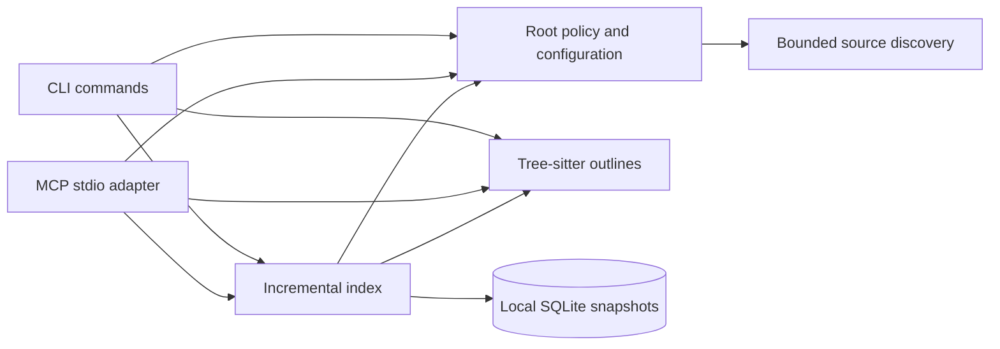

<div align="center">


# ContextForge

**Local repository context. Built for coding assistants.**

One local Rust engine with CLI, Desktop and MCP interfaces for repository intelligence.

[](https://github.com/MohamedRF/ContextForge/actions/workflows/ci.yml)
[](LICENSE)
[](rust-toolchain.toml)
[](docs/roadmap.md)

[Quick start](#quick-start) · [CLI](#cli-reference) · [MCP](#mcp-server) · [Architecture](docs/architecture.md) · [Roadmap](docs/roadmap.md)

</div>

## Desktop preview

ContextForge now includes a Tauri 2 desktop interface alongside its independent
CLI and MCP stdio server. All interfaces reuse the Rust indexing, search, graph,
Git impact and context engines and the existing repository cache format.

The desktop provides native repository selection, indexing/cancellation, cited
search, source outlines, dependency visualization, Git impact, context packaging,
and reviewed MCP configuration changes. See the [desktop guide](docs/desktop-user-guide.md)
and [architecture](docs/desktop-architecture.md). Unsigned previews are not signed
production releases; installation and platform validation are recorded per release.

Developer workflow (Node 24 and Tauri platform prerequisites required):

```text
cd apps/desktop
npm ci
npm run build
npm run tauri -- dev
```


---

ContextForge gives coding tools a repeatable view of a local source tree. It discovers eligible files, stores source snapshots in SQLite, and updates changed records without executing project code. A stdio MCP server exposes seven source-backed retrieval tools to compatible clients.

**Current stage:** discovery, storage, Tree-sitter outlines, indexed search, bounded syntax graphs, read-only Git impact, token-budgeted context and persistent knowledge controls work through the Rust CLI; all seven retrieval tools are available over MCP. Call/import targets remain heuristic or unknown. Harness installation verification and further security hardening remain open. This checkout is a development version after the published desktop developer preview; it is not the complete v0.1 MVP.

## What works today

- **Local operation** — no model, API key, telemetry, or source upload is required at runtime.
- **Incremental storage** — SHA-256 fingerprints detect source edits; SQLite transactions update changed records and remove obsolete paths.
- **Repository boundaries** — explicit roots, scoped ignore rules, size limits, and symlink/junction checks.
- **Predictable output** — deterministic file inventories, JSON CLI output, and protocol-only MCP stdout.
- **Failure recovery** — regression tests cover interrupted writes, concurrent indexers, corruption, and unsupported schemas.

| Capability | Status |
|---|---|
| CLI, configuration, status, diagnostics | Implemented |
| Source discovery and incremental SQLite snapshots | Implemented |
| MCP `project_map` | Implemented; tested with the official Rust SDK client |
| Tree-sitter outlines and MCP `symbol_lookup` | Implemented; current-source file outlines |
| FTS5 search and indexed exact/qualified symbol lookup | Implemented via CLI `search` and MCP `search_context` |
| Bounded syntax dependency graphs and qualified references | Implemented; explicit heuristic/unknown targets |
| Git changed ranges and likely impact | Implemented; old/new source evidence, no safety verdict |
| Token-budgeted context packing | Implemented; explicit serialized JSON estimator |
| Structural knowledge status/clear/rebuild | Implemented; hash validation and transactional lifecycle |
| Harness configuration previews | Implemented for Claude Code, Codex, Cursor and VS Code; manual merge only |
| Prebuilt releases | Published as an unsigned desktop developer preview; source installs remain supported |

## Quick start

Prerequisites: [Rust](https://www.rust-lang.org/tools/install), Cargo, Git, and the native linker/build tools for your platform. The repository pins **Rust 1.99.1** and builds bundled SQLite, so a C compiler is required. Format, Clippy, tests, and release builds have passed in CI on **Windows, Linux, and macOS**. See the [release CI run](https://github.com/MohamedRF/ContextForge/actions/runs/41174192276) and [latest CI results](https://github.com/MohamedRF/ContextForge/actions).

```sh
git clone https://github.com/MohamedRF/ContextForge.git
cd ContextForge
cargo build --workspace --release --locked
cargo install --path crates/contextforge-cli --locked
contextforge --version
```

`cargo install --path` installs from this checkout. A crates.io package is not published. Prebuilt desktop preview binaries and CLI ZIPs are attached to the [v0.1.0 desktop preview release](https://github.com/MohamedRF/ContextForge/releases/tag/v0.1.0-desktop-preview.1). Ensure Cargo's binary directory is on your PATH.

Point ContextForge at a repository or source directory:

```sh
contextforge --root /path/to/project init
contextforge --root /path/to/project index
contextforge --root /path/to/project --json status
contextforge --root /path/to/project project-map --limit 100
```

On Windows, use a quoted native path such as `--root "C:\Projects\my-app"`. Without `--root`, ContextForge discovers the nearest ancestor containing `.git` or `.contextforge`. An explicit root also supports directories without Git.

Initialization creates `.contextforge/config.toml`. Indexing stores source text in managed metadata. Add `.contextforge/` to the target project's ignore rules yourself; ContextForge does not edit its `.gitignore`.

### Incremental indexing example

For a fixture containing one source file, the first index returns:

```json
{"schema_version":2,"added":1,"modified":0,"unchanged":0,"deleted":0,"total_files":1,"parsed_files":1,"partial_files":0}
```

Reindexing the unchanged fixture returns:

```json
{"schema_version":2,"added":0,"modified":0,"unchanged":1,"deleted":0,"total_files":1,"parsed_files":0,"partial_files":0}
```

Eligible files are read and hashed on each run. Only changed database rows are written. Renames are handled as deletion plus addition. Status reports `freshness: "not_checked"`; it does not assert that cached source still matches the working tree.

## CLI reference

| Command | Purpose |
|---|---|
| `contextforge --help` | Show commands and options |
| `contextforge --version` | Show the development version |
| `contextforge init` | Create managed configuration without overwriting existing config |
| `contextforge index` | Create or incrementally update source snapshots |
| `contextforge status` | Inspect configuration and stored index metadata |
| `contextforge doctor` | Check root/config access, discovery, and index metadata |
| `contextforge project-map --limit 100` | List eligible source files |
| `contextforge analyze <relative-file> --limit 200` | Outline current source syntax |
| `contextforge search <query> --limit 20 --offset 0` | Search indexed symbols, filenames and source text |
| `contextforge graph <selector> --direction incoming --depth 2` | Explore bounded likely dependents in captured syntax |
| `contextforge references <selector>` | Show candidate and unresolved references |
| `contextforge impact [--staged\|--base <ref>\|--file <path>]` | Inspect Git changed code and likely impact |
| `contextforge context <query> --budget 4000 [--git]` | Pack deduplicated cited source as budgeted compact JSON |
| `contextforge memory <status\|clear\|rebuild>` | Validate or explicitly reset/rebuild local structural knowledge |
| `contextforge mcp` | Start the stdio MCP server |
| `contextforge setup <claude\|codex\|cursor\|vscode> [--dry-run]` | Preview client-specific configuration without changing settings |

Global options: `--root <directory>`, `--json`, and `--verbose`. Diagnostics go to stderr. In MCP mode, stdout is reserved for protocol messages.

## MCP server

Launch the same binary with a fixed authorized root:

```sh
contextforge --root /path/to/project mcp
```

Use these executable/argument values when configuring a stdio-capable MCP client:

```json
{
  "command": "contextforge",
  "args": ["--root", "/path/to/project", "mcp"]
}
```

This is a generic server launch descriptor, not a complete configuration file for any specific harness. Use the absolute executable path if the client's environment does not include Cargo's binary directory.

The inventory tool is **`project_map`**. It accepts an optional `limit` from 1 to 1000 and returns relative paths, language classifications, byte counts, and truncation metadata. It inventories files without creating or refreshing an index. Clients cannot override the server's root through tool arguments.

**`symbol_lookup`** returns a current-file syntax outline from a relative `path`.
**`search_context`** searches an explicitly captured index with a literal `query`,
optional `limit` and `offset`. Search returns cited snippets and fingerprints with
unchecked snapshot freshness. See [search behavior](docs/search.md) and
[syntax coverage](docs/parsing.md). Neither tool refreshes the index implicitly.

**`dependency_graph`** and **`find_references`** expose the captured syntax graph.
**`analyze_change`** inspects current Git snapshots without shell commands or
metadata writes. See [graph certainty and limits](docs/graph.md) and
[Git modes and impact evidence](docs/impact.md).

**`pack_context`** accepts `query`, optional `budget` and opt-in `include_git`.
It returns deduplicated source evidence within the named estimator's budget,
including compact package JSON overhead. This is not exact model tokenization;
the MCP envelope is outside that budget. See [context packing](docs/context.md)
and [persistent knowledge commands](docs/memory.md).

Initialize → list → call and clean EOF shutdown are tested with the official `rmcp` client and raw protocol tests. See the [MCP contract](docs/mcp-tools.md).

### Configure a coding harness

```sh
contextforge --root /path/to/project setup claude --dry-run
contextforge --root /path/to/project setup codex --dry-run
contextforge --root /path/to/project setup cursor --dry-run
contextforge --root /path/to/project setup vscode --dry-run
```

Setup prints a fragment and destination; it never modifies settings. Back up the
destination and merge only the generated entry, preserving existing servers.
The previews use Claude's project `.mcp.json`, Codex's `config.toml`, Cursor's
project `.cursor/mcp.json`, and VS Code's workspace `.vscode/mcp.json`, with each
client's documented schema. Generate them using your installed binary's stable
location. Reload the client, review trust prompts and call `project_map`, then
`search_context` with an indexed symbol.

All four formats are parser-tested, and their descriptors launch the real server
through the official MCP client. Installed Codex CLI also parses its generated
configuration in an isolated home. Actual agent-session calls remain unverified
for all four. See [configuration instructions, official sources and verification
steps](docs/integrations.md).

## Configuration and supported files

Generated `.contextforge/config.toml`:

```toml
version = 1
index_root = "index"
max_file_bytes = 1048576
ignore_patterns = []
```

Relative index roots live beneath `.contextforge`; an absolute path selects external cache storage. Each repository gets a separate namespace derived from its canonical root. Patterns use gitignore syntax.

| Classification | Extensions |
|---|---|
| Rust | `.rs` |
| Python | `.py` |
| TypeScript | `.ts`, `.tsx` |
| JavaScript | `.js`, `.jsx`, `.mjs`, `.cjs` |

All four languages have Tree-sitter syntax outlines; see [parser coverage and limits](docs/parsing.md). Discovery respects scoped `.gitignore`, `.contextforgeignore`, and configured exclusions. Binary data, invalid UTF-8, links, generated directories, and oversized files are skipped by policy.

Current index limits are **1000 eligible files**, **10000 yielded entries**, **depth 64**, and **64 MiB of snapshot text**. The default per-file limit is 1 MiB, configurable up to 16 MiB. A truncated inventory aborts indexing rather than deleting records from an incomplete scan. See [storage and privacy](docs/storage.md) for details.

## Architecture



The workspace has seven crates: `contextforge-core` for root policy/discovery, `contextforge-index` for persistence/SQL search and knowledge lifecycle, `contextforge-parser` for syntax outlines, `contextforge-graph` for pure candidate graphs, `contextforge-git` for read-only snapshot impact, `contextforge-context` for budgeted retrieval and `contextforge-cli` for commands and MCP. Domain code stays independent of the transport. Read the [architecture document](docs/architecture.md) for trust boundaries and design decisions.

## Validation and performance

The test suite covers repository boundaries, incremental indexing, syntax parsing,
search, dependency graphs, Git impact, context budgets, and MCP protocol behavior.
See the [development guide](docs/development.md) for quality checks and
[benchmark methodology](docs/benchmarking.md) for measurements and their limits.

## Security and limitations

Source code remains read-only; only explicitly managed metadata is written. There is no runtime network service or project-code execution. Source text is untrusted data, never operational instructions.

The index contains source bodies and may therefore contain source-embedded secrets. Keep caches private. SQLite resource limits and cancellable MCP waits are implemented; native workers retain their permits until finished. Filesystem races, Windows cache hard links/ACL validation, strict peer/process quotas and hostile-cache hardening remain open. Use local stdio and trusted cache locations; see the [security model](docs/security.md).

Report vulnerabilities through the process in [SECURITY.md](SECURITY.md). For implementation limits, see [storage](docs/storage.md) and [architecture](docs/architecture.md).

## Roadmap and contributing

Next work includes remaining security hardening, actual harness-session verification,
opt-in configuration updates and clean-machine/cross-platform package validation.
`memory status` validates observed source hashes; search/graph/context retain their
explicit captured-snapshot contracts. See [known limits](docs/known-limits.md) and
[local packaging and release checklist](docs/release.md).

See the [roadmap](docs/roadmap.md), [changelog](CHANGELOG.md), and [contribution guide](CONTRIBUTING.md). Small, tested changes and reproducible bug reports are welcome.

## License

[MIT](LICENSE) © 2026 MohamedRF.
