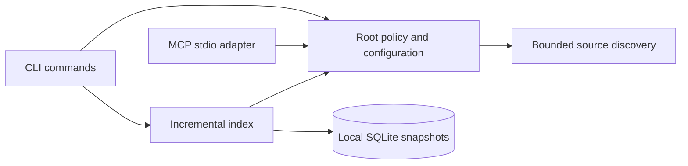

<div align="center">

# ContextForge

**Local repository context. Built for coding assistants.**

A Rust CLI and MCP server for bounded source discovery and incremental local indexing.

[](https://github.com/MohamedRF/ContextForge/actions/workflows/ci.yml)
[](LICENSE)
[](rust-toolchain.toml)
[](docs/roadmap.md)

[Quick start](#quick-start) · [CLI](#cli-reference) · [MCP](#mcp-server) · [Architecture](docs/architecture.md) · [Roadmap](docs/roadmap.md)

</div>

---

ContextForge gives coding tools a repeatable view of a local source tree. It discovers eligible files, stores source snapshots in SQLite, and updates changed records without executing project code. A stdio MCP server exposes a bounded source-file inventory to compatible clients.

**Current stage:** discovery, storage, and the CLI/MCP foundation are implemented. Parsing, symbol lookup, full-text search, dependency graphs, and change-impact analysis are planned. This checkout is an unreleased development version; it is not the complete v0.1 MVP.

## What works today

- **Local operation** — no model, API key, telemetry, or source upload is required at runtime.
- **Incremental storage** — SHA-256 fingerprints detect source edits; SQLite transactions update changed records and remove obsolete paths.
- **Repository boundaries** — explicit roots, scoped ignore rules, size limits, and symlink/junction checks.
- **Predictable output** — deterministic file inventories, JSON CLI output, and protocol-only MCP stdout.
- **Failure recovery** — regression tests cover interrupted writes, concurrent indexers, corruption, and unsupported schemas.

| Capability | Status |
|---|---|
| CLI, configuration, status, diagnostics | Implemented |
| Source discovery and incremental SQLite snapshots | Implemented |
| MCP `project_map` | Implemented; tested with the official Rust SDK client |
| Tree-sitter symbols and outlines | Planned |
| FTS5 search and symbol lookup | Planned |
| Dependency graphs, Git impact, context packing | Planned |
| Harness setup helpers and prebuilt releases | Planned |

## Quick start

Prerequisites: [Rust](https://www.rust-lang.org/tools/install), Cargo, Git, and the native linker/build tools for your platform. The repository pins **Rust 1.99.1** and builds bundled SQLite, so a C compiler is required. Format, Clippy, tests, and release builds have passed in CI on **Windows, Linux, and macOS**. See the [verified workflow run](https://github.com/MohamedRF/ContextForge/actions/runs/41014286004) and [latest CI results](https://github.com/MohamedRF/ContextForge/actions).

```sh
git clone https://github.com/MohamedRF/ContextForge.git
cd ContextForge
cargo build --workspace --release --locked
cargo install --path crates/contextforge-cli --locked
contextforge --version
```

`cargo install --path` installs from this checkout. A crates.io package and prebuilt releases are not published yet. Ensure Cargo's binary directory is on your PATH.

Point ContextForge at a repository or source directory:

```sh
contextforge --root /path/to/project init
contextforge --root /path/to/project index
contextforge --root /path/to/project --json status
contextforge --root /path/to/project project-map --limit 100
```

On Windows, use a quoted native path such as `--root "C:\Projects\my-app"`. Without `--root`, ContextForge discovers the nearest ancestor containing `.git` or `.contextforge`. An explicit root also supports directories without Git.

Initialization creates `.contextforge/config.toml`. Indexing stores source text in managed metadata. Add `.contextforge/` to the target project's ignore rules yourself; ContextForge does not edit its `.gitignore`.

### Incremental indexing example

For a fixture containing one source file, the first index returns:

```json
{"schema_version":1,"added":1,"modified":0,"unchanged":0,"deleted":0,"total_files":1}
```

Reindexing the unchanged fixture returns:

```json
{"schema_version":1,"added":0,"modified":0,"unchanged":1,"deleted":0,"total_files":1}
```

Eligible files are read and hashed on each run. Only changed database rows are written. Renames are handled as deletion plus addition. Status reports `freshness: "not_checked"`; it does not assert that cached source still matches the working tree.

## CLI reference

| Command | Purpose |
|---|---|
| `contextforge --help` | Show commands and options |
| `contextforge --version` | Show the development version |
| `contextforge init` | Create managed configuration without overwriting existing config |
| `contextforge index` | Create or incrementally update source snapshots |
| `contextforge status` | Inspect configuration and stored index metadata |
| `contextforge doctor` | Check root/config access, discovery, and index metadata |
| `contextforge project-map --limit 100` | List eligible source files |
| `contextforge mcp` | Start the stdio MCP server |

Global options: `--root <directory>`, `--json`, and `--verbose`. Diagnostics go to stderr. In MCP mode, stdout is reserved for protocol messages.

## MCP server

Launch the same binary with a fixed authorized root:

```sh
contextforge --root /path/to/project mcp
```

Use these executable/argument values when configuring a stdio-capable MCP client:

```json
{
  "command": "contextforge",
  "args": ["--root", "/path/to/project", "mcp"]
}
```

This is a generic server launch descriptor, not a complete configuration file for any specific harness. Use the absolute executable path if the client's environment does not include Cargo's binary directory.

The only exposed tool is **`project_map`**. It accepts an optional `limit` from 1 to 1000 and returns relative paths, language classifications, byte counts, and truncation metadata. It inventories files without creating or refreshing an index. Clients cannot override the server's root through tool arguments.

Initialize → list → call and clean EOF shutdown are tested with the official `rmcp` client and raw protocol tests. Claude Code, Codex, Cursor, and VS Code installation paths have not yet been verified. See the [MCP contract](docs/mcp-tools.md).

## Configuration and supported files

Generated `.contextforge/config.toml`:

```toml
version = 1
index_root = "index"
max_file_bytes = 1048576
ignore_patterns = []
```

Relative index roots live beneath `.contextforge`; an absolute path selects external cache storage. Each repository gets a separate namespace derived from its canonical root. Patterns use gitignore syntax.

| Classification | Extensions |
|---|---|
| Rust | `.rs` |
| Python | `.py` |
| TypeScript | `.ts`, `.tsx` |
| JavaScript | `.js`, `.jsx`, `.mjs`, `.cjs` |

These are file classifications, not implemented syntax parsers. Discovery respects scoped `.gitignore`, `.contextforgeignore`, and configured exclusions. Binary data, invalid UTF-8, links, generated directories, and oversized files are skipped by policy.

Current index limits are **1000 eligible files**, **10000 yielded entries**, **depth 64**, and **64 MiB of snapshot text**. The default per-file limit is 1 MiB, configurable up to 16 MiB. A truncated inventory aborts indexing rather than deleting records from an incomplete scan. See [storage and privacy](docs/storage.md) for details.

## Architecture



The workspace has three crates: `contextforge-core` for root policy and discovery, `contextforge-index` for persistence, and `contextforge-cli` for commands and the MCP adapter. Domain code stays independent of the transport. Read the [architecture document](docs/architecture.md) for trust boundaries and design decisions.

## Validation and performance

The Phase 2 Windows baseline passed **22 behavior tests**, formatting, Clippy with warnings denied, and a release build. Tests include Unicode paths, invalid config, ignore rules, path escapes, junctions, index lifecycle, transaction rollback, abrupt writer exit, and MCP protocol handling.

A single diagnostic run over 100 generated Rust files measured **115 ms cold indexing**, **103 ms unchanged reindexing**, and **28 KiB of SQLite storage**, using a debug build on an Intel i7-7700 Windows host. This is a small fixture measurement, not a throughput or speedup claim. [Method, environment, and reproduction](docs/benchmarking.md).

## Security and limitations

Source code remains read-only; only explicitly managed metadata is written. There is no runtime network service or project-code execution. Source text is untrusted data, never operational instructions.

The index contains source bodies and may therefore contain source-embedded secrets. Keep caches private. Filesystem race protection, hard-linked or hostile caches, cancellation, and resource hardening remain development work. Use local stdio and trusted cache locations; this is not a hardened remote service.

Report vulnerabilities through the process in [SECURITY.md](SECURITY.md). For implementation limits, see [storage](docs/storage.md) and [architecture](docs/architecture.md).

## Roadmap and contributing

The next milestone is Tree-sitter symbol extraction, followed by indexed search and symbol lookup. Later work adds evidence-qualified dependencies, Git impact, token-budgeted context, harness integrations, and release packaging.

See the [roadmap](docs/roadmap.md), [verified task tracker](TASKS.md), [changelog](CHANGELOG.md), and [contribution guide](CONTRIBUTING.md). Small, tested changes and reproducible bug reports are welcome.

## License

[MIT](LICENSE) © 2026 MohamedRF.
