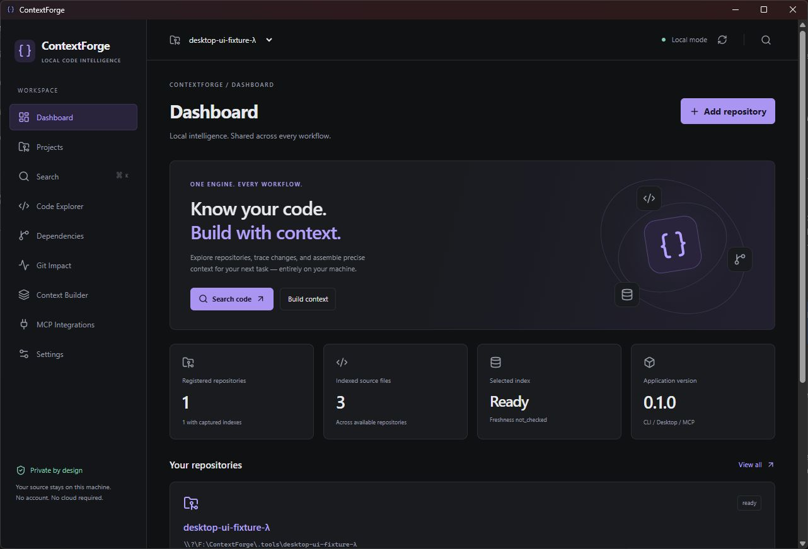
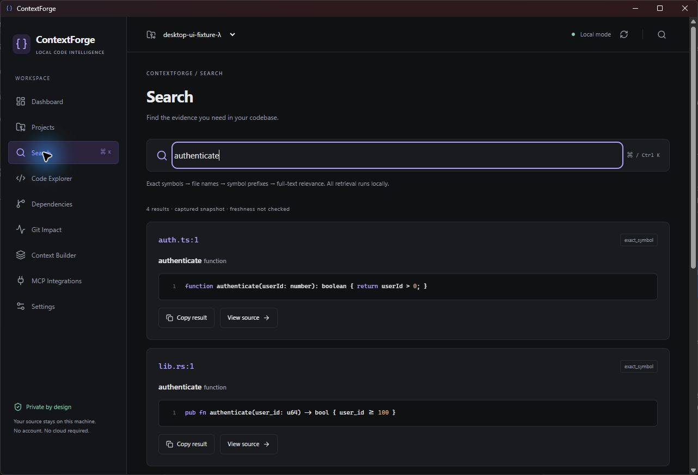
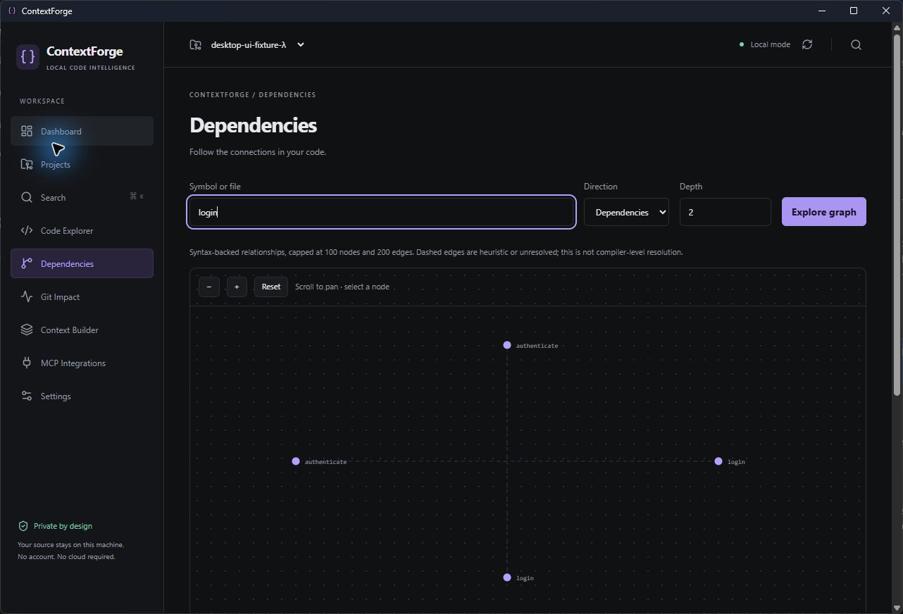

# ContextForge Desktop preview

ContextForge Desktop is a local Tauri 2 application over the same Rust engine as
the standalone CLI and `contextforge mcp` stdio server. Core features require no
account, HTTP server or cloud provider. This is an unsigned developer preview,
not a signed production distribution. See the release's platform evidence.

## Actual Windows preview

These captures come from an installed Windows developer build, using a disposable
Unicode-path fixture and the real shared Rust backend. They are not mockups.







## Install

Download the artifact matching your operating system and architecture and verify
its SHA-256 sidecar. Windows packages use NSIS and require Microsoft WebView2;
the installer can bootstrap WebView2, which may require a network connection on
machines without it. Core indexing and retrieval work offline after installation.
Normal operation does not require administrator privileges.

For macOS, open the matching ARM64 or Intel DMG and copy ContextForge.app to
Applications. Preview builds are unsigned and not notarized; managed-machine
policies may prevent launching them. Production signing/notarization is not
claimed. Do not disable system security controls to install a preview.

Download and extract the companion CLI ZIP to a stable private location if using
MCP. The desktop installer does **not** modify PATH or shell configuration. The
CLI is independently usable; keeping the GUI open is unnecessary for MCP.

## First repository

1. Choose **Add repository** and select an existing folder in the native dialog.
2. Choose **Index**. Initialization creates `.contextforge/config.toml` only if
   missing. Indexing writes only managed cache data, never source files.
3. Follow the progress banner. **Cancel** cooperatively aborts and rolls back any
   pending index update, preserving the previously committed snapshot.
4. Search a symbol, file or literal phrase. Results display source citations,
   retrieval methods and clipping. Ctrl+K / Cmd+K opens search.
5. Open a result to inspect current source and syntax outlines in Code Explorer.

The parser currently supports Rust, Python, TypeScript/TSX and JavaScript/JSX.
Discovery/indexing is capped at 1,000 eligible files and 64 MiB input per snapshot.
Oversized/truncated indexes fail explicitly instead of silently deleting rows.
Source previews return at most 200 lines / 64 KiB at a time. Huge single lines
can exceed the preview cap. Outlines and graph traversal also have explicit limits.

**Unregister** removes only the project registration. Source files, configuration
and captured indexes are preserved. Moved/missing roots are marked unavailable;
register the new location explicitly. There is no destructive cache-cleanup button.

## Explore and build context

**Dependencies** accepts an exact symbol name, qualified name, ID or relative file
path. Choose incoming/outgoing relationships and a bounded depth. Zoom with the
controls, scroll to pan and select nodes to inspect citations. Dashed edges are
heuristic evidence, not compiler-confirmed semantic bindings. Use a selected node
as the next starting point, then run Explore again. Results cap at 100 nodes and
200 edges. The source-evidence section exposes relationship provenance.

**Git Impact** compares unstaged, staged or branch merge-base changes. It displays
changed ranges, changed symbols, confirmed structural dependents, possible
dependents and candidate tests. No detected dependents is never a safety verdict.
This preview shows changed ranges rather than a full textual patch viewer.

**Context Builder** uses the shared Rust packing algorithm. Enter a task, set a
256–32,000 estimated-token budget and optionally use unstaged Git proximity.
Copy Markdown or JSON and follow source references. The estimate is compact
serialized UTF-8 bytes / 4 rounded up, not an exact model tokenizer. Truncation,
inclusion reasons and confidence remain visible. Save copied output in your
editor when a persistent context artifact is needed.

Search/graph/context evidence is captured data whose freshness is not implicitly
verified. Code Explorer reads current source; re-index explicitly after changes.
There is no automatic refresh daemon, semantic embedding provider or cloud LLM.

## MCP integration manager

Choose Claude Code, Codex, Cursor or VS Code / Copilot. **Select CLI & preview**
opens a native file picker; choose the extracted ContextForge CLI, not the GUI.
An absolute executable/root launch configuration is generated in Rust.

Review the entry and choose **Apply reviewed change**. A native confirmation is
required. Existing JSON/TOML is parsed, unrelated values preserved, and the
original file backed up alongside it before atomic replacement. Changes since
preview are rejected. Formatting/comments may be normalized; JSONC is deliberately
rejected instead of stripping comments. Backup filenames start `contextforge-backup-`.
Backups can contain client secrets; keep them private and apply your normal
retention policy. Cooperating ContextForge writers use an OS file lock; other
client software should be closed during changes to avoid noncooperating writes.

Claude uses `<repository>/.mcp.json`, Cursor `.cursor/mcp.json`, VS Code
`.vscode/mcp.json`, and Codex `$CODEX_HOME/config.toml` (default `~/.codex/config.toml`).
Preview removal follows the same confirmation/backup path and removes only
ContextForge's entry. **Validate** checks syntax and entry presence; it does not
claim a running connection or verify that the chosen binary is ContextForge.

Restart/reload the client, accept its server trust prompt, list tools and call
`project_map`, then `search_context`. Client-specific configuration conventions
can change: see [integration references](integrations.md) and the installed
client's documentation. A configuration file alone never means “connected.”

## Storage and preferences

All interfaces use the existing repository `.contextforge/config.toml` and
SQLite cache schema. An absolute `index_root` remains supported. Source snapshots
are sensitive: exclude `.contextforge/` from commits and keep the cache private.
Schema migration is transactional; incompatible future schemas fail closed.
Do not edit schema versions manually. Back up private caches before upgrades.

The shared project registry (`projects.sqlite`) and theme/project selection use
the native per-user local data directory (`directories::ProjectDirs`): typically
`%LOCALAPPDATA%/ContextForge/ContextForge/data` on Windows and
`~/Library/Application Support/dev.ContextForge.ContextForge` on macOS. The
library's native resolution is authoritative. Window size/position are separately
persisted by Tauri's window-state plugin under the app's configuration directory.

CLI registry commands work outside a repository:

```text
contextforge projects list
contextforge projects add <absolute-or-relative-folder>
contextforge projects remove <id>
contextforge --root <folder> search <query> --json
```

Themes support system, dark and light. Other indexing policy settings continue to
use the canonical TOML config; the preview does not expose unsupported GUI knobs.

## Build and troubleshooting

Install the pinned Rust toolchain and Tauri's platform prerequisites, plus Node 24.
From `apps/desktop`, run `npm ci`, `npm run build`, then `npm run tauri -- dev`
or `npm run tauri -- build`. Use MSVC prerequisites for normal Windows distribution.
The local GNU build is additional development evidence, not a substitute for CI.
macOS packaging must run on macOS. See [Tauri prerequisites](https://v2.tauri.app/start/prerequisites/).

If search fails, verify repository access and run Index. Unsupported schema or
corruption must be investigated; preserve metadata rather than deleting it.
If indexing is busy, another process may hold the repository lock. Retry after it
finishes; cancellation is supported while waiting. OS locks release after crashes.
If client configuration changed, preview again instead of forcing replacement.

The UI has no arbitrary filesystem/shell permissions or remote navigation. Root
and relative path validation, ignore rules and symlink/reparse protection execute
in Rust. Existing hostile filesystem replacement/cache permission limits remain
documented in [security](security.md). Report release-specific problems with the
OS/architecture, version and safe error text; do not upload source caches/secrets.
